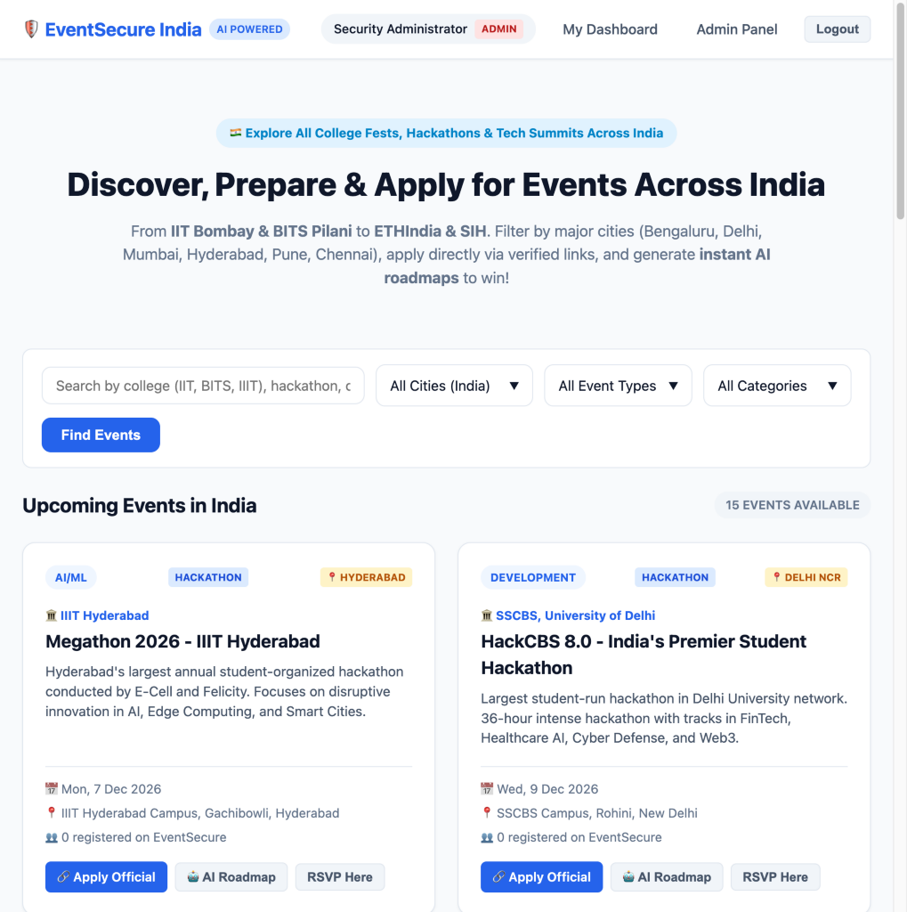
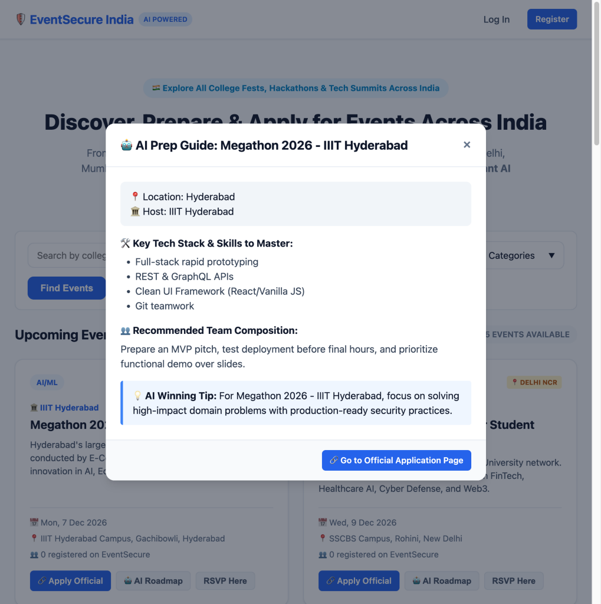
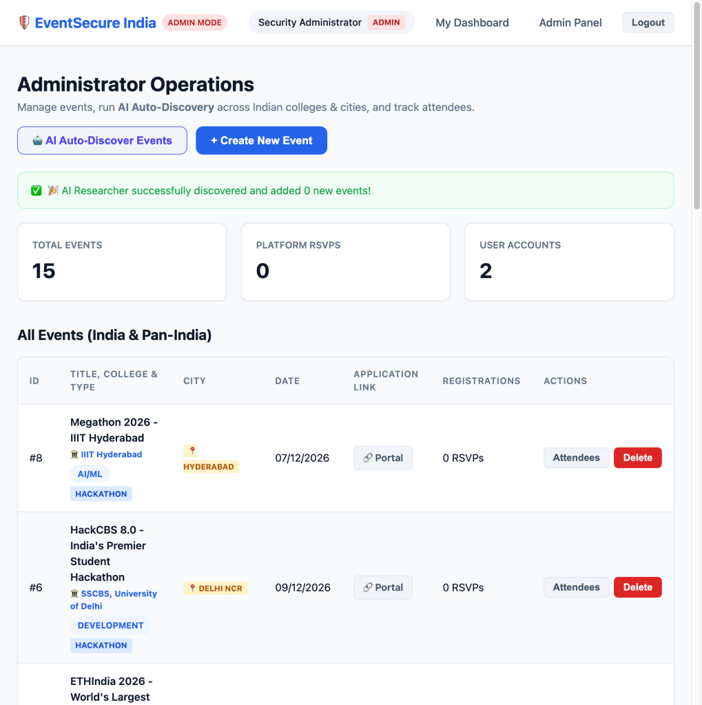

# 🛡️ EventSecure India - AI-Powered College & Tech Event Intelligence

A full-stack, security-hardened event discovery platform built with Python, Flask, and SQLAlchemy. It automatically tracks, researches, and curates tech conferences, national hackathons, and college technical fests across India, complete with direct official application links, city filters, and AI-generated preparation roadmaps.

---

## 📸 Interface Preview

### 🇮🇳 1. Pan-India Events Catalog with City & College Filters
*Browse events across Bengaluru, Delhi NCR, Mumbai, Hyderabad, Pune, Chennai, and Kolkata with verified application links.*



---

### 🤖 2. AI Event Preparation Roadmap & Skill Guide
*Instant AI-generated technical roadmaps, recommended team structures, and tactical tips for any hackathon or fest.*



---

### ⚡ 3. Admin Command Center with Real-Time AI Auto-Discovery
*One-click AI research engine that discovers, validates, and ingests upcoming events into the database without duplicates.*



---

## 💡 What This Platform Does (In Simple Words)

1. **Find College Fests & Hackathons Across India**: Explore premier events from institutes like **IIT Bombay (Techfest)**, **IIT Madras (Shaastra)**, **BITS Pilani (APOGEE)**, **IIIT Hyderabad (Megathon)**, **IIT Delhi (Tryst)**, and national hackathons like **Smart India Hackathon (SIH)** and **ETHIndia**.
2. **Direct Official Application Links**: Every event provides an authentic, validated external portal link so students and developers can register immediately on the official website.
3. **Multi-City & Category Sorting**: Filter events by top tech hubs (Bengaluru, Delhi NCR, Mumbai, Hyderabad, Pune, Chennai, Ahmedabad, Kolkata, Jaipur) and event categories (Hackathons, College Fests, Conferences, Workshops).
4. **AI-Powered Event Researcher**: Administrators can click one button to trigger the AI engine, which researches real-world events across India, verifies dates and links, and automatically inserts them into the live database.
5. **AI Prep Guides for Participants**: Attendees can click the **AI Roadmap** button on any event card to receive an instant breakdown of required tech stacks (e.g., Solidity for ETHIndia, PyTorch for AI hackathons), ideal team compositions, and winning strategies.
6. **Defensive Security Standards**: Built with prepared statements (zero SQL injection), BCrypt password hashing, JWT expiration, XSS-safe DOM rendering, rate limiting against brute-force attacks, and safe file uploads.

---

## ⚡ Quick Start (Local Setup)

The project runs locally with **SQLite by default**, requiring zero external database setup.

### 1. Set Up Environment
```bash
# Clone the repository
git clone https://github.com/theashokjagarwal/secure-event-manager.git
cd secure-event-manager

# Create and activate virtual environment
python3 -m venv venv
source venv/bin/activate    # On Windows: venv\Scripts\activate

# Install dependencies
pip install -r requirements.txt
```

### 2. Launch Application
```bash
python run.py
```
Open **`http://127.0.0.1:5050`** in your browser.

### 🔑 Seeded Demo Accounts
| Role | Email | Password | Access Level |
|---|---|---|---|
| **Administrator** | `admin@example.com` | `Admin@12345` | `/admin` (AI Auto-Discovery, Event Management) |
| **Attendee** | `user@example.com` | `User@12345` | `/dashboard` (Personal RSVPs, Schedule Downloads) |

---

## 🗄️ Database Architecture: SQLite to MySQL Without Rewriting Code

The database layer in `app/database.py` uses SQLAlchemy ORM, isolating database operations from backend logic.

To switch from SQLite to MySQL:
1. Open your `.env` file.
2. Change the configuration:
   ```ini
   DB_TYPE=mysql
   DB_HOST=localhost
   DB_PORT=3306
   DB_NAME=secure_events
   DB_USER=your_mysql_user
   DB_PASSWORD=your_mysql_password
   ```
3. Restart `python run.py`. SQLAlchemy will automatically create tables and manage connections via MySQL connection pooling.

---

## 🛡️ Security Features & Defensive Controls

1. **SQL Injection Defense**: All database queries use SQLAlchemy ORM parameterized statements (`filter`, `filter_by`). User input is never concatenated directly into SQL strings.
2. **Password Security**: Passwords are salted and hashed using BCrypt. Passwords are verified in constant time to eliminate timing attacks.
3. **JWT Authentication & RBAC**: Stateless authentication with cryptographic HMAC-SHA256 signatures, expiration claims (`exp`), and `@admin_required` route decorators.
4. **XSS Prevention**: Frontend JavaScript uses `textContent` and `document.createElement`. User strings are never injected into `innerHTML`. Content Security Policy (CSP) headers block unauthorized external scripts.
5. **URL & Link Validation**: External application links are validated server-side to enforce `https://` or `http://` protocols, neutralizing `javascript:` URI injection attacks.
6. **CSRF Mitigation**: Mutating endpoints require `POST`, `PUT`, or `DELETE` methods, `SameSite=Lax` cookies, and custom headers (`X-Requested-With`).
7. **File Upload Security**: Uploads are restricted to `.pdf`, `.docx`, `.png`, `.jpg`, and capped at 5MB. Magic-byte inspection verifies file headers, and files are stored with random UUID names outside web-accessible roots. Executables (`.exe`, `.sh`, `.bat`) are rejected.
8. **Rate Limiting & Anti-Enumeration**: Authentication endpoints throttle requests to 5 attempts per minute per IP, responding with HTTP 429. Failed logins return generic messages (`Invalid email or password`) to prevent account harvesting.
9. **Environment Variable Isolation**: Secrets are kept in `.env` and excluded from version control via `.gitignore`.
10. **Structured Logging**: Failed logins and administrative changes are logged with client IP addresses and timestamps. Sensitive credentials and tokens are scrubbed from log outputs.

---

## 🧪 Automated Testing Lab

The repository includes 19 comprehensive unit and integration tests covering security controls, AI capabilities, and city filtering:

```bash
python -m unittest discover tests -v
```

### Verified Test Cases:
* **SQL Injection**: Blocks `' OR '1'='1` and union-based extraction attempts.
* **BCrypt Hashing**: Verifies unique salts and slow one-way encryption.
* **JWT Security**: Rejects tampered tokens and expired sessions.
* **Role-Based Access Control**: Rejects non-admin users from administrative and AI auto-discovery endpoints with HTTP 403.
* **Rate Limiting**: Enforces HTTP 429 after 5 failed login attempts.
* **File Upload Defense**: Blocks scripts (`.sh`, `.exe`, `.bat`), verifies magic bytes for valid documents.
* **URL Sanitization**: Blocks `javascript:` pseudo-protocol attacks in application links.
* **AI Roadmap Generator**: Verifies skill extraction, team strategies, and tactical tips.
* **City & College Filtering**: Confirms accurate event retrieval by Indian metropolitan areas and college names.
* **Full Lifecycle**: End-to-end user registration, login, event creation, attendee RSVP, and cancellation.

---

## 📂 Project Structure

```
secure-event-manager/
├── .env.example              # Documented environment variable template
├── .env                      # Local development secrets (git-ignored)
├── .gitignore                # Protects secrets, databases, and logs
├── README.md                 # Project documentation and user guide
├── requirements.txt          # Python dependencies
├── run.py                    # Application launch script
├── app/
│   ├── __init__.py           # Flask factory, CSP headers, error handlers
│   ├── config.py             # Settings, file limits, and environment loader
│   ├── database.py           # SQLAlchemy abstraction layer (SQLite / MySQL)
│   ├── models.py             # User, Event, Registration ORM entities
│   ├── security.py           # BCrypt, JWT, RBAC, validators, rate limiting
│   ├── ai_service.py         # AI Event Researcher & Roadmap Generator
│   ├── routes/
│   │   ├── auth_routes.py    # Authentication endpoints
│   │   ├── event_routes.py   # Public events, city filters, AI prep guides
│   │   └── admin_routes.py   # Event management & AI auto-discovery API
│   ├── static/
│   │   ├── css/style.css     # Responsive design system
│   │   └── js/
│   │       ├── api.js        # Safe DOM builder, CSRF headers, API client
│   │       ├── auth.js       # Route guards, password strength meter
│   │       ├── events.js     # Public catalog, city filters, AI roadmap modal
│   │       └── admin.js      # Admin console & AI discovery controller
│   ├── templates/
│   │   ├── index.html        # Public discovery page with Indian city filters
│   │   ├── login.html        # Authentication view
│   │   ├── register.html     # Registration with real-time checklist
│   │   ├── dashboard.html    # Attendee management dashboard
│   │   └── admin.html        # Administrator console with AI discovery modal
│   └── uploads/              # Secure directory for document attachments
├── docs/
│   └── images/               # High-resolution screenshots
└── tests/
    ├── test_security.py      # Core security unit tests
    ├── test_ai_features.py   # AI features, URL validation, and city filters
    └── test_e2e.py           # Complete application integration test
```
