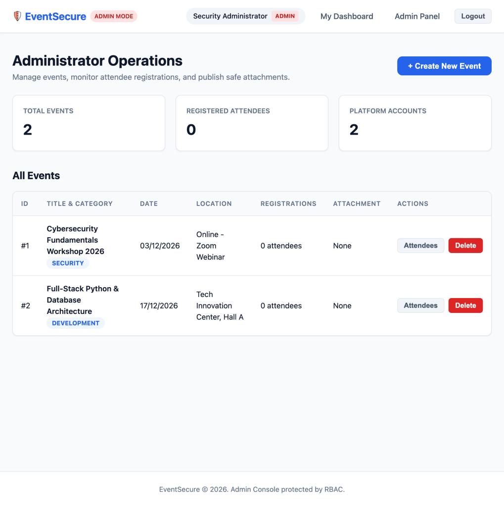
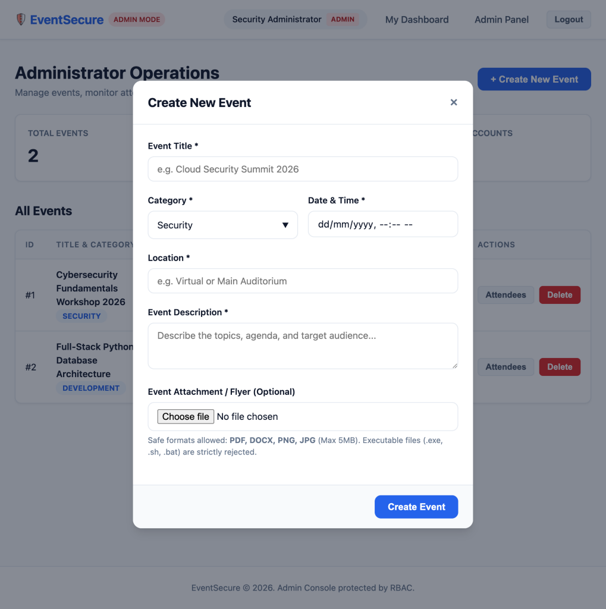

<div align="center">

# 🛡️ EventSecure

### *The Bulletproof Full-Stack Event Platform Built for Modern Web Defense*

[](https://www.python.org/)
[](https://flask.palletsprojects.com/)
[](https://www.sqlalchemy.org/)
[](#-the-10-security-pillars-explained-simply)
[](#-switch-from-sqlite-to-mysql-in-10-seconds)
[](file:///Users/apple/.gemini/antigravity/scratch/secure-event-manager/tests)
[](LICENSE)

<br/>

<p align="center">
  <strong>Stop building tutorials with vulnerable code.</strong><br/>
  EventSecure is a clean, developer-friendly event management application designed from the ground up with <b>zero security compromises</b>.
</p>

[Quick Start](#-quick-start-in-60-seconds) •
[What It Does](#-what-is-eventsecure-in-simple-words) •
[Screenshots](#-screenshots) •
[Security Features](#-the-10-security-pillars-explained-simply) •
[SQLite to MySQL](#-switch-from-sqlite-to-mysql-in-10-seconds) •
[Run Tests](#-automated-security-lab-test-suite)

</div>

---

## 📸 Screenshots

<div align="center">

### 🌐 1. Public Event Discovery & Catalog
*Browse upcoming tech conferences, filter by categories, and search dynamically without XSS vulnerabilities.*


<br/><br/>

### ⚙️ 2. Admin Command Center & Metrics Dashboard
*Real-time attendee stats, event management, and Role-Based Access Control (RBAC).*



<br/><br/>

### 📁 3. Hardened Event Creation & Secure File Upload
*Upload flyers and guides with extension whitelisting, MIME magic-byte verification, and UUID isolation.*



</div>

---

## 💡 What is EventSecure? (In Simple Words)

Most online web development tutorials teach beginner developers how to build an app, but they leave out security. They concatenate user strings into database queries, store plain-text passwords, and allow users to upload malicious script files. 

**EventSecure solves this.** It is a complete, beginner-friendly web application where:
1. **Regular Attendees** can browse tech events, search topics, create secure accounts, register for events with one click, and download official schedules.
2. **Administrators** have a dedicated protected portal to create events, monitor attendee registrations, and upload session attachments safely.
3. **Every Single Interaction** is fortified against real-world cyberattacks (SQL injection, XSS, CSRF, brute-forcing, executable uploads, and credential leaks).

---

## 🚀 Quick Start (In 60 Seconds)

EventSecure runs locally with **zero database configuration** — it uses SQLite by default!

### 1. Clone & Enter Project
```bash
git clone https://github.com/theashokjagarwal/secure-event-manager.git
cd secure-event-manager
```

### 2. Setup Virtual Environment
```bash
# Create virtual environment
python3 -m venv venv

# Activate it (macOS/Linux)
source venv/bin/activate

# Windows users:
# venv\Scripts\activate

# Install dependencies
pip install -r requirements.txt
```

### 3. Launch App
```bash
python run.py
```
👉 Open your browser to **`http://127.0.0.1:5050`**

### 🔑 Instant Test Accounts
The database automatically seeds two ready-to-test accounts on first launch:

| Role | Email | Password | Privileges |
|---|---|---|---|
| **Admin** | `admin@example.com` | `Admin@12345` | Full access to `/admin`, create/delete events, view attendees |
| **User** | `user@example.com` | `User@12345` | Access to `/dashboard`, register/cancel event RSVPs |

---

## 🔄 Switch from SQLite to MySQL in 10 Seconds

EventSecure uses a clean **ORM Abstraction Layer (SQLAlchemy)**. Your business logic, controllers, and queries never interact with database-specific syntax.

```
       [ Frontend UI & REST APIs ]
                    │
                    ▼
     [ SQLAlchemy ORM Abstraction ]  <-- Parameterized queries (Zero SQL injection)
                    │
        ┌───────────┴───────────┐
        ▼                       ▼
  [ SQLite Engine ]       [ MySQL Engine ]
   (Local zero-setup)     (Production-ready)
```

### To switch to MySQL:
Simply update your `.env` file:
```ini
# Change this:
DB_TYPE=mysql

# Set your MySQL server credentials:
DB_HOST=localhost
DB_PORT=3306
DB_NAME=secure_events
DB_USER=your_mysql_username
DB_PASSWORD=your_mysql_password
```
Restart the app:
```bash
python run.py
```
**Zero backend code changes needed.** The tables, relationships, and seed data will be created automatically in MySQL.

---

## 🛡️ The 10 Security Pillars (Explained Simply)

Every feature in EventSecure comes with comments in the source code explaining *why* it is there:

### 1. 💉 SQL Injection Prevention
* **The Danger:** Attackers type SQL code like `' OR '1'='1` into login or search boxes to trick the database into handing over private data.
* **Our Defense:** We never use string concatenation (`f"SELECT... {input}"`). Instead, SQLAlchemy converts all inputs into **parameterized queries**, treating all inputs as harmless text.

### 2. 🔐 BCrypt Password Hashing
* **The Danger:** If a database is breached and passwords are stored in plain text or fast hashes (MD5/SHA1), hackers immediately read everyone's credentials.
* **Our Defense:** Passwords are encrypted with **BCrypt**, which adds a random cryptographic salt and uses a deliberate, slow key-derivation function. We verify passwords in constant time to prevent timing attacks.

### 3. 🎫 JWT Authentication & RBAC
* **The Danger:** Attackers fake user IDs or edit tokens to grant themselves administrator privileges.
* **Our Defense:** Authenticated sessions use cryptographically signed **JSON Web Tokens (JWT)** with strict expiration times (`exp`). Admin-only endpoints verify both token signature and the user's role claim via `@admin_required`.

### 4. 🛑 Cross-Site Scripting (XSS) Prevention
* **The Danger:** Hackers submit malicious `<script>` tags in event titles to run malware on other visitors' machines.
* **Our Defense:** All frontend JavaScript uses `textContent` and safe DOM builders. Untrusted data is **never** assigned to `innerHTML`. In addition, strict **Content Security Policy (CSP)** HTTP headers prevent unauthorized external scripts.

### 5. 🎭 Cross-Site Request Forgery (CSRF) Mitigation
* **The Danger:** A malicious external site tricks a user's browser into deleting an event or registering without their knowledge.
* **Our Defense:** State changes strictly require `POST`, `PUT`, or `DELETE` verbs with `SameSite=Lax` cookies and custom `X-Requested-With: XMLHttpRequest` headers that cross-origin scripts cannot forge.

### 6. 🔍 Dual Input Validation & Sanitization
* **The Danger:** Oversized inputs cause buffer overflows; malicious characters crash backend parsers.
* **Our Defense:** Dual-layer checks (in JavaScript for instant feedback, and in Python for bulletproof security). Validates email formats, password complexity (uppercase, lowercase, number, special char), and future date constraints.

### 7. ☣️ Secure File Uploads (No Executable Malware)
* **The Danger:** Attackers upload `.php`, `.sh`, or `.exe` files or use path traversal (`../../shell.sh`) to gain remote command execution on the server.
* **Our Defense:**
  - Whitelist only safe formats: `.pdf`, `.docx`, `.png`, `.jpg`.
  - Rejects scripts and executables explicitly.
  - Inspects file **magic bytes** (ensuring a file named `flyer.png` is an authentic image, not a renamed script).
  - Saves files with randomized **UUID filenames** outside the web root to eliminate path traversal.

### 8. ⏱️ Rate Limiting & User Enumeration Defense
* **The Danger:** Automated bots make 10,000 login attempts per second to guess user passwords.
* **Our Defense:** Sliding window rate limiter throttles authentication to 5 attempts per minute per IP (returns HTTP 429). Authentication errors return generic responses (`"Invalid email or password"`) so attackers cannot discover valid emails.

### 9. 🔒 Environment Variable Isolation
* **The Danger:** Accidentally pushing database passwords or secret keys to a public GitHub repository.
* **Our Defense:** All secrets live in `.env` (loaded with `python-dotenv`). `.gitignore` guarantees that `.env` and SQLite `.db` files never touch Git. A clean, documented `.env.example` is provided.

### 10. 📝 Auditing & Scrubbed Logging
* **The Danger:** Logs that expose sensitive passwords or fail to record security breaches.
* **Our Defense:** Failed login attempts and administrative actions are logged with IP addresses and timestamps to `app.log`. Passwords and authorization tokens are strictly scrubbed.

---

## 🔬 Automated Security Lab (Test Suite)

EventSecure includes 14 comprehensive unit and integration tests verifying every defensive layer:

```bash
python -m unittest discover tests -v
```

```
test_sql_injection_in_login_email       ... OK (Blocks ' OR '1'='1)
test_sql_injection_in_search_events     ... OK (Escapes union queries)
test_bcrypt_password_hashing            ... OK (Salts & hashes properly)
test_jwt_tampering_rejected             ... OK (Rejects forged signatures)
test_jwt_expiration                     ... OK (Rejects expired tokens)
test_regular_user_cannot_access_admin   ... OK (Returns 403 Forbidden)
test_admin_can_access_admin_api         ... OK (Allows valid admin)
test_auth_rate_limiting                 ... OK (Returns 429 Too Many Requests)
test_blocked_executable_upload          ... OK (Blocks .sh, .exe, .bat)
test_allowed_pdf_upload                 ... OK (Accepts verified PDF)
test_weak_password_rejected             ... OK (Enforces complexity)
test_past_event_date_rejected           ... OK (Enforces future dates)
test_security_headers_present           ... OK (CSP, nosniff, DENY)
test_full_application_lifecycle         ... OK (End-to-End integration test)
----------------------------------------------------------------------
Ran 14 tests in 9.6s - ALL TESTS PASSED!
```

---

## 📂 Project Architecture

```
secure-event-manager/
├── .env.example              # Documented environment template
├── .env                      # Local development secrets (git-ignored)
├── .gitignore                # Protects secrets, databases, and logs
├── README.md                 # Project documentation & security guide
├── requirements.txt          # Python dependencies
├── run.py                    # Application entry point
├── app/
│   ├── __init__.py           # Flask app factory, CSP headers, error handlers
│   ├── config.py             # Configuration loader & whitelist rules
│   ├── database.py           # SQLAlchemy layer (SQLite / MySQL)
│   ├── models.py             # User, Event, Registration ORM entities
│   ├── security.py           # BCrypt, JWT, RBAC, validators, rate limiting
│   ├── routes/
│   │   ├── auth_routes.py    # Login, register, logout, profile
│   │   ├── event_routes.py   # Public catalog, RSVP, attachment downloads
│   │   └── admin_routes.py   # Admin operations & analytics
│   ├── static/
│   │   ├── css/style.css     # Clean responsive modern design system
│   │   └── js/
│   │       ├── api.js        # Safe DOM builder, CSRF headers, JWT client
│   │       ├── auth.js       # Route guards, real-time password checklist
│   │       ├── events.js     # Public catalog & attendee dashboard
│   │       └── admin.js      # Admin table controller & file validation
│   ├── templates/
│   │   ├── index.html        # Public event discovery
│   │   ├── login.html        # Clean login interface
│   │   ├── register.html     # Registration with password strength meter
│   │   ├── dashboard.html    # Attendee dashboard
│   │   └── admin.html        # Admin management console
│   └── uploads/              # Isolated directory for secure file storage
├── docs/
│   └── images/               # High-resolution screenshots
└── tests/
    ├── test_security.py      # 13 dedicated security unit tests
    └── test_e2e.py           # End-to-end integration test
```

---

## 🤝 Contributing

Contributions, issues, and feature requests are welcome!
1. Fork the repository
2. Create your feature branch (`git checkout -b feature/NewFeature`)
3. Commit your changes (`git commit -m 'Add awesome feature'`)
4. Push to the branch (`git push origin feature/NewFeature`)
5. Open a Pull Request

---

## 🌟 Show Your Support

If you found this project helpful for learning web security or clean architecture, please give it a **⭐ Star** on GitHub!

---

## 📜 License

Distributed under the **MIT License**. See `LICENSE` for more information.
